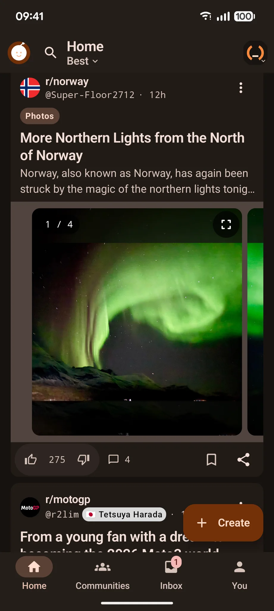
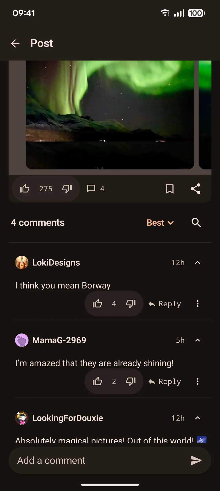
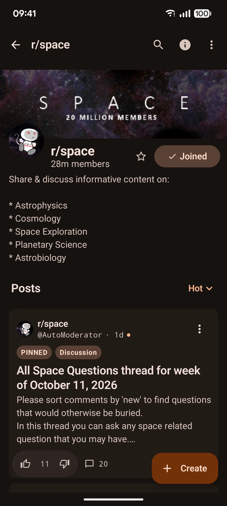
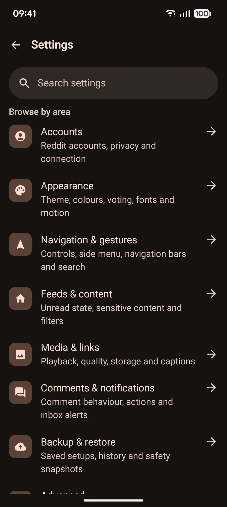

# subshell

**An independent Android client for Reddit**, built for everyday Reddit use:
reading, writing, chatting and moderating, with no ads and no tracking.

**[Download the current public beta (0.81-beta)](https://github.com/brealorg/subshell/releases/tag/v0.81-beta)** ·
[Get started](https://brealorg.github.io/subshell/get-started/) ·
[Website](https://brealorg.github.io/subshell/) ·
[FAQ](https://brealorg.github.io/subshell/faq/) ·
[r/subshell](https://www.reddit.com/r/subshell/)

  
  
  
  

## Reddit, the Android way

### Built for reading.

Feeds that remember your place, threads that load replies by themselves, and comments that stay readable on any screen.

- Unread markers and highlighted new comments
- Find in thread and jump between top-level comments
- Swipe actions and vote controls the way you like them

### Photos and video, done properly.

Galleries, a full-screen viewer and Reddit video that adapts to your connection.

- Share and save images in one tap
- Video quality per network, subtitles and audio language
- Optional speed, double-tap skip and picture-in-picture

### Your communities, your rules.

Favorites, custom feeds and recent communities close at hand, and the tools to keep the rest out of the way.

- Join, favorite, mute for a while or hide
- Content filters for words, users, domains and flair
- Community info, rules and wiki without leaving the app

### Make it yours.

Searchable settings, grouped the way you think about them, with defaults that follow Android.

- Follows your light or dark theme, with dynamic colour and pure black
- Left- or right-handed controls and navigation
- Backups to a folder you own, and an optional app lock

**Also in subshell:** Direct Chat, Inbox notifications, Modmail and mod tools, Several accounts, Tablets and foldables, Saved searches, Share into subshell, No ads, no tracking.

## Get started

1. **Install the APK.** Download the signed beta from [GitHub Releases](https://github.com/brealorg/subshell/releases/tag/v0.81-beta).
   Each release has a `.sha256` checksum and a release record so the APK can be verified.
2. **Get a Client ID.** Once, through RedReader's Reddit sign-in. The app shows you how;
   the [guide](https://brealorg.github.io/subshell/get-started/) has the same steps.
3. **Sign in** on Reddit's own page. Add more accounts any time.

Android 8.0 or newer. subshell checks for new betas itself and opens the release
page; it never installs anything on its own.

<!-- RELEASETOOL02_WHATS_NEW_START -->
## What's new in 0.81-beta

Feed videos keep their shape

- Fixed: tall and very wide videos in the feed were stretched and cut off at the edge while playing.
- Mention people in comments: type @ or u/ for people from the thread, then Reddit's people search.
- Subshell checks for updates when you come back to it, so a new release shows up within the hour.
- The update dialog can turn on update notifications if Android has them switched off.

[All release notes](https://brealorg.github.io/subshell/changelog/)
<!-- RELEASETOOL02_WHATS_NEW_END -->

## Privacy

No advertising, analytics, crash reporting or tracking. subshell talks to Reddit
for you; your sign-in and Client ID stay encrypted on your device, and backups go
to a folder you choose. See the [privacy notice](https://brealorg.github.io/subshell/privacy/).

## Feedback

- [Report a bug](https://github.com/brealorg/subshell/issues/new?template=bug_report.yml)
- [Request a feature](https://github.com/brealorg/subshell/issues/new?template=feature_request.yml)
- [Report a vulnerability privately](https://github.com/brealorg/subshell/security/advisories/new)
- [Discuss subshell on r/subshell](https://www.reddit.com/r/subshell/)

When reporting a problem, include the subshell version, Android version, device
model when relevant, and clear reproduction steps. Remove usernames, message
contents, tokens, cookies and other private account information from screenshots
and logs.

## Repository scope

This repository is the public project, release, documentation,
issue-tracking, and website home for subshell.

The Android application source code is published separately in [brealorg/subshell-source-public](https://github.com/brealorg/subshell-source-public),
one snapshot per release, under the GNU General Public License v3.0 or later.
That repository is read-only; report bugs and ideas here.

Public APKs are published only after passing the project's release
qualification and signing gates.

## Independence

subshell is independent software and is not affiliated with, endorsed by,
or sponsored by Reddit.
