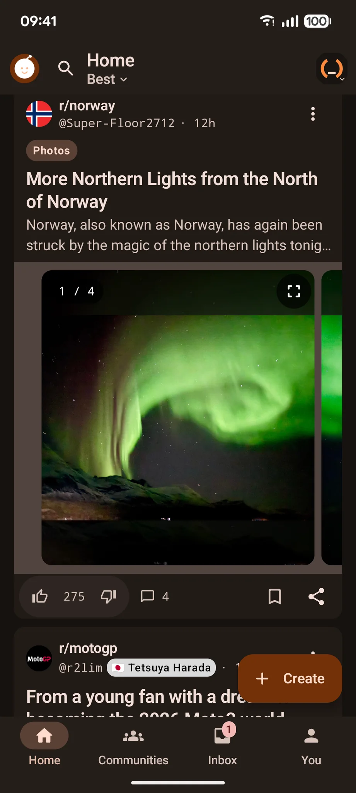
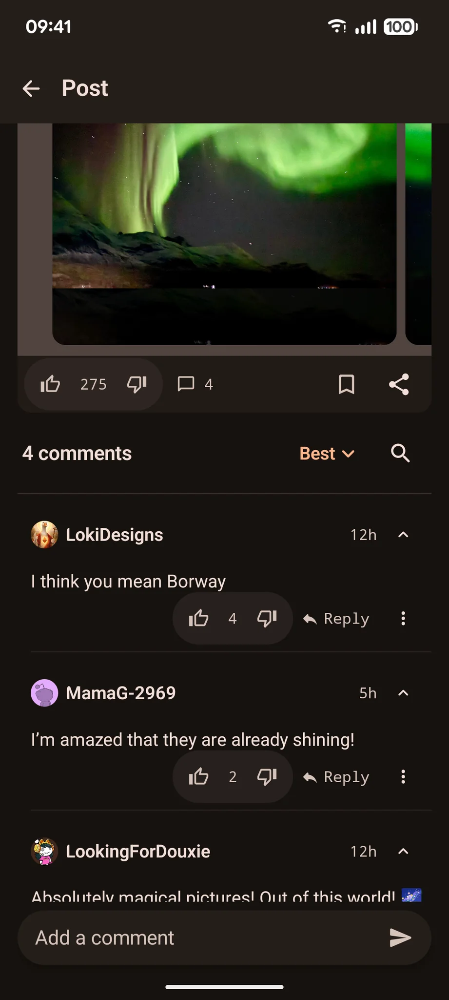
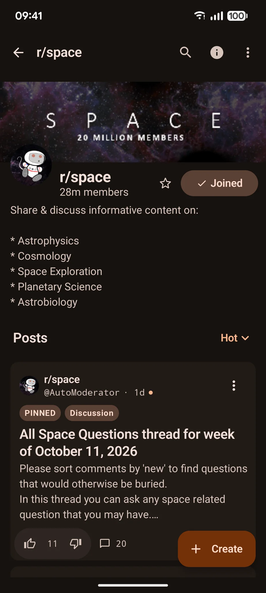
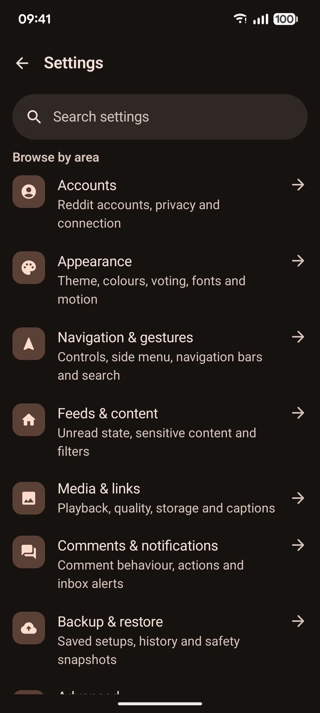

# subshell for Reddit

**An independent Android client for Reddit**, for people who read and moderate a lot.
No ads, no analytics, no tracking.

**[Download the current public beta (1.0.0-rc.2)](https://github.com/brealorg/subshell/releases/tag/v1.0.0-rc.2)** ·
[Get started](https://brealorg.github.io/subshell/get-started/) ·
[Add to Obtainium](https://apps.obtainium.imranr.dev/redirect?r=obtainium://app/%7B%22id%22%3A%22io.github.brealorg.subshell%22%2C%22url%22%3A%22https%3A%2F%2Fgithub.com%2Fbrealorg%2Fsubshell%22%2C%22author%22%3A%22brealorg%22%2C%22name%22%3A%22subshell%22%2C%22additionalSettings%22%3A%22%7B%5C%22includePrereleases%5C%22%3Atrue%7D%22%7D) ·
[Website](https://brealorg.github.io/subshell/) ·
[FAQ](https://brealorg.github.io/subshell/faq/) ·
[r/subshell](https://www.reddit.com/r/subshell/)

  
  
  
  

## What you get

- **Keeps your place** in feeds, also after the app was closed (optional)
- **Threads you can read:** replies load by themselves, find in thread, new comments highlighted
- **Moderator tools:** queue, removal reasons, mod log, Modmail
- **Filters, mutes and notifications:** hide what you do not want, hear about what you do
- **Offline, backup and export:** save your feed, back up to a folder you own, export your Reddit data
- **No ads, no analytics, no crash reporting.** Open source, GPL-3.0-or-later

It is a beta, and you need your own Reddit Client ID once (see below). Android 8.0 or newer.

**[Everything it does, and what it does not →](#everything-it-does)**

<!-- FEATURES_README_START -->
## Everything it does

Open a group to see every feature in it. **(off)** means it is off until you turn it on in Settings. **(next release)** means it is not in 1.0.0-rc.2 yet.

<strong>Read</strong>

- **Feeds:** Home, Popular, All, and custom feeds you create, edit and favourite. Four layouts: Large, Compact, List (thumbnail on either side), Grid.
- **Sorting:** Best, Hot, New, Rising, Top, Controversial, with a time range where Reddit offers one. Each community remembers its own sort.
- **Your place is kept.** A feed stays where it was when you open a post and go back, per account. Resume where you left off after the app was closed (off), either as you left it or by loading new posts and finding your place within four pages.
- **No "load more" buttons.** Pages and replies load as you scroll.
- **Unread markers** on posts you have not opened. Hide posts you have read, or forget what counts as read.
- **Pinned posts** as cards or a compact row. A row saying how many posts your filters hid, with a way to show them (off). A scroll indicator on feeds and threads (off).
- **Save for offline:** the top 50 posts of your feed with their comment threads and images. Not video.
- **Swipe actions** on posts and comments: upvote, downvote, save, hide or nothing, per direction (off).
- **Flair:** tap a post's flair to search that flair in the community, newest first. **(next release)**
- **Random NSFW community,** placed where you choose (off).

<strong>Threads</strong>

- **Replies load by themselves,** with guide lines or parent connectors; thread colours by depth or in one colour (off).
- **Find in thread:** search the comments, step through matches, open collapsed branches, and limit it to the post author's comments with the OP chip.
- **New comments** since your last visit are highlighted and counted in the header.
- **Jump** to the next or previous top-level comment (off).
- **Comment sort:** Best, Top, New, Controversial, Old. Reddit's suggested sort is used for you.
- **Collapse** a comment by tapping it or its header. Collapse long post text (off).
- **Comments show** avatars, code blocks with a copy button, spoilers, and inline images and GIFs. Choice of three code fonts.
- **Jump to a comment** from a link, a notification or a comment you just wrote.

<strong>Find</strong>

- **Search** posts, communities and people from one field: all of Reddit or just the current community. Sort and time range. Recent searches.
- **Paste a Reddit link** to open it in the app. Links to reddit.com and redd.it open in the app: posts, comments, communities, users, searches, wiki pages and custom feeds.
- **Saved searches:** up to 50 per account (off).
- **Language filter** for search and discovery: results in languages you did not pick are hidden, decided on the device (Android 10+, off). **(next release)**
- **Communities:** join, leave, favourite; About, rules, moderators and a read-only wiki; your own flair; quarantined communities you can opt in to.
- **Profiles** with posts and comments; block and unblock. Your own library: saved, upvoted, downvoted, hidden, drafts.

<strong>Photos and video</strong>

- **Galleries** and a **full-screen viewer** with zoom, share and save to Downloads. Captions as overlay, below or hidden.
- **Reddit video:** one plays at a time in the feed. Quality limit per network (High on Wi-Fi and Medium on mobile data by default), subtitles, audio language. Videos start muted. Autoplay Always, Wi-Fi only or Never.
- **Optional video controls (all off):** playback speed, double-tap to skip, hold for 2x, pinch to zoom, picture-in-picture, rotate for wide videos, technical details.
- **Landscape full screen:** swipe the left half for brightness and the right half for volume.
- **Sensitive media** is blurred by default; choose load on tap or hide. NSFW media only plays automatically if you turn that on.
- **RedGIFs** clips in NSFW posts play in the app.
- **Storage:** video cache of 256 MB to 2 GB (1 GB by default), clear caches from Settings.

<strong>Write</strong>

- **Post composer** for text, link and media (up to 20 images) with community picker, flair, title, formatting toolbar and preview. It checks the community's posting requirements before you send.
- **Comment composer** with image and GIF where the community allows them. Reply, edit and delete your own comments; edit, manage (flair, NSFW, spoiler) and delete your own posts.
- **Drafts** for posts and replies. **Crosspost.** **Mention suggestions:** typing `@` or `u/` suggests people from the thread first.
- **Private notes** on usernames: a colour label and a note, never sent to Reddit.
- **Share into subshell** from other apps (off).

<strong>Moderate</strong>

- **Mod tools** per community: the queue, the mod log, user management (ban, mute, approve) and the moderator team with permissions. The Removed, Edited and Unmoderated lists, and a REMOVED mark on posts, are **(next release)**.
- **One Moderate menu** on every post and comment: approve, remove, spam, change flair, lock, distinguish, reports. **(next release)**
- **Removal reasons** and an optional message to the author. Saved responses.
- **Modmail** with replies and internal notes. A cross-community queue in the Inbox.

<strong>Stay informed</strong>

- **Inbox:** replies, mentions, private messages, Reddit notices and, for moderators, Mod. Mark read, dismiss, select.
- **Notifications** per type: replies, mentions, private messages, Reddit notices, Modmail. Messages arrive as conversations and can be answered from the notification.
- **New-post notifications** for up to ten communities you watch, and optionally each new comment.
- **Direct Chat** and private messages: text, images and GIFs, reactions, typing indicator, delete your own.
- **Widgets** for the Inbox and for posts from Home or a community. **Launcher shortcuts** for communities (off).

<strong>Control what you see</strong>

- **Content filters:** words, communities, users, domains and flair, everywhere or in one community. Nothing changes on Reddit.
- **Mute a community** for an hour, a day, a week, until a date or for good. Choose whether a direct visit shows posts or only About.
- **Hide a joined community** from your list without leaving it. Optionally require device unlock before hidden communities show.
- **NSFW** posts and media are off until you turn them on.

<strong>Look and feel</strong>

- Light, dark or system theme, dynamic colour (Android 12+), pure black. UI size 85 to 110 % and text size 85 to 130 %. Vote buttons as thumbs or arrows, with vote colours.
- Left- or right-handed controls and side menu. Top and bottom bars that hide on scroll. Navigation labels. Communities written as r/name, /r/name or name.
- Tablets and foldables: navigation rail, list and detail side by side, tabletop posture for video.
- Reduce motion, TalkBack actions on feed cards, 48 dp touch targets.
- Searchable settings in ten areas.

<strong>Your data and privacy</strong>

- **No ads, no analytics, no crash reporting.** The app contains no Firebase or Google Play services.
- **Sign-in and Client ID are stored encrypted** on the device. Android's own cloud backup is switched off.
- **What is about you is stored encrypted** with a key in the Android Keystore: your inbox, your joined-community list, your saved, upvoted, downvoted and hidden lists, your reading counts, the communities you hide or mute, your private notes on users, your saved searches, your post drafts, your saved moderator responses, your search history and favourites, and the home and saved feeds you have loaded. Posts and comments from public feeds are not. This keeps the files unreadable to anything that copies them off the phone without the key; it does not protect against someone using your unlocked phone. **(next release)**
- **App lock** with biometrics or screen lock (off). Notifications can hide their content while it is on.
- **Your reading** (off): counts of opens and time per community, kept on the device only, with suggestions to hide or leave communities you never open.
- **Backup** your settings to a folder you choose. Hidden and muted communities, drafts, saved moderator responses and private notes are included only if you say so.
- **Export your Reddit data** (saved, votes, posts, comments, communities, messages and more) as JSON and CSV in one ZIP.
- **Several accounts,** switched from the bottom bar. Everything account-specific is kept per account.
- **Open source,** GPL-3.0-or-later.

<strong>Install and update</strong>

- Android 8.0 or newer. You need your own Reddit Client ID once ([how](https://brealorg.github.io/subshell/get-started/)).
- **Updates inside the app:** Settings › Updates. The APK is checked against a published SHA-256 before Android is asked to install it.
- **What's new** shows after an update. The full history is the [changelog](https://brealorg.github.io/subshell/changelog/).

<strong>Not supported</strong>

- Video download (saving an image, and exporting a video to Downloads/subshell, work).
- Alt text for images, viewing or writing.
- Voting in polls (results show; voting opens Reddit). Editing a wiki.
- Background audio.
- YouTube, Streamable and Imgur albums have no special handling; they open as links.
- Public posts and comments in the offline cache, image and video caches, cookies for Direct Chat, the app's display settings and the backups and exports you make yourself are not encrypted by the app. Your sign-in and Client ID are, and from the next release so is what is listed under Your data and privacy.

<!-- FEATURES_README_END -->

## Get started

1. **Install the APK.** Download the signed beta from [GitHub Releases](https://github.com/brealorg/subshell/releases/tag/v1.0.0-rc.2).
   Each release has a `.sha256` checksum and a release record, so a damaged download shows up.
   The checksum sits next to the APK, so it only catches a damaged download. To check that the APK
   is really signed by subshell, compare its signing certificate with this SHA-256 fingerprint:

   `52:E9:62:E7:41:2E:25:DA:80:1E:0A:39:06:E0:BF:B4:39:90:0A:1A:A1:5B:A9:F9:3C:95:B4:99:55:BA:F5:84`

   On a computer: `apksigner verify --print-certs Subshell-<version>.apk` (Android SDK build-tools)
   prints it as `Signer #1 certificate SHA-256 digest`. On the phone, the AppVerifier app checks it.
2. **Get a Client ID.** Once, through RedReader's Reddit sign-in. The app shows you how;
   the [guide](https://brealorg.github.io/subshell/get-started/) has the same steps.
3. **Sign in** on Reddit's own page. Add more accounts any time.

Android 8.0 or newer. subshell checks for new versions itself. Update in
Settings › Updates downloads the release APK from GitHub, checks it against the
published SHA-256 and hands it to Android, which asks you before it installs.

<!-- RELEASETOOL02_WHATS_NEW_START -->
## What's new in 1.0.0-rc.2

The Update button in the update dialog now updates the app

- The "subshell update available" dialog now has an Update button that downloads and installs the update inside the app. Before, it only led to the GitHub page.
- Everything else is the same as 1.0 release candidate 1 and 0.92. If Update or What's new does not work for you, tell us on r/subshell or GitHub.

[All release notes](https://brealorg.github.io/subshell/changelog/)
<!-- RELEASETOOL02_WHATS_NEW_END -->

## Privacy

No advertising, analytics, crash reporting or tracking. subshell talks to Reddit
for you; your sign-in and Client ID stay encrypted on your device, and backups go
to a folder you choose. See the [privacy notice](https://brealorg.github.io/subshell/privacy/).

## Feedback

- [Report a bug](https://github.com/brealorg/subshell/issues/new?template=bug_report.yml)
- [Request a feature](https://github.com/brealorg/subshell/issues/new?template=feature_request.yml)
- [Report a vulnerability privately](https://github.com/brealorg/subshell/security/advisories/new)
- [Discuss subshell on r/subshell](https://www.reddit.com/r/subshell/)

When reporting a problem, include the subshell version, Android version, device
model when relevant, and clear reproduction steps. Remove usernames, message
contents, tokens, cookies and other private account information from screenshots
and logs.

## Repository scope

This repository is the public project, release, documentation,
issue-tracking, and website home for subshell.

The Android application source code is published separately in [brealorg/subshell-source-public](https://github.com/brealorg/subshell-source-public),
one snapshot per release, under the GNU General Public License v3.0 or later.
That repository is read-only; report bugs and ideas here.

Public APKs are published only after passing the project's release
qualification and signing gates.

subshell is written by one developer with help from AI coding tools; every change
is reviewed and tested on a real phone before it ships.

## Independence

subshell is independent software and is not affiliated with, endorsed by,
or sponsored by Reddit.
